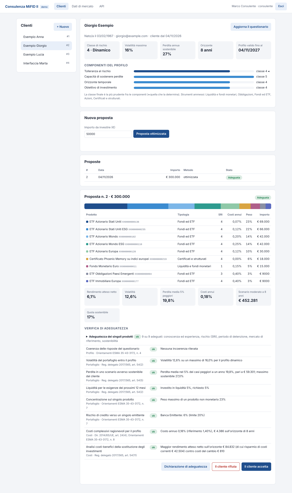
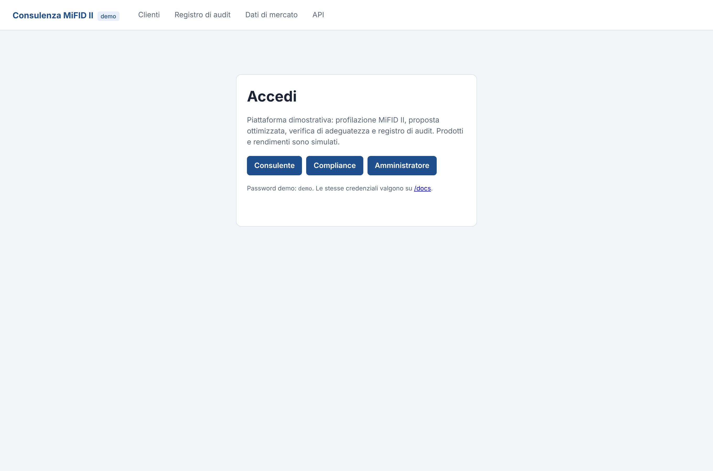
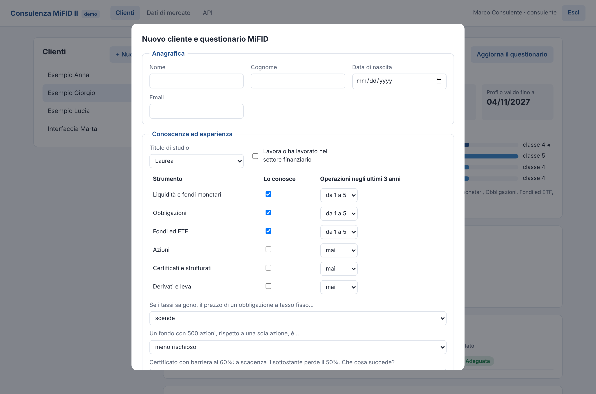
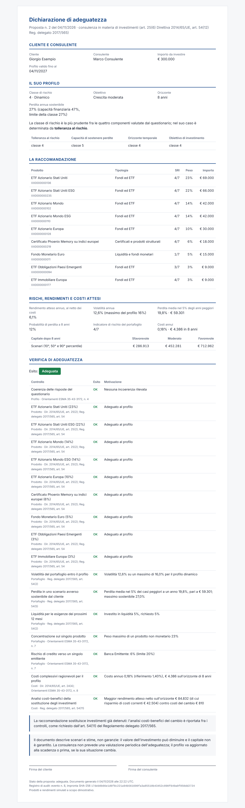
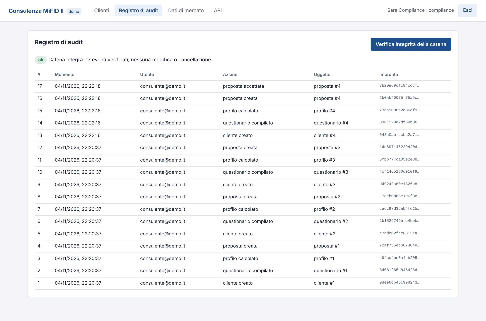
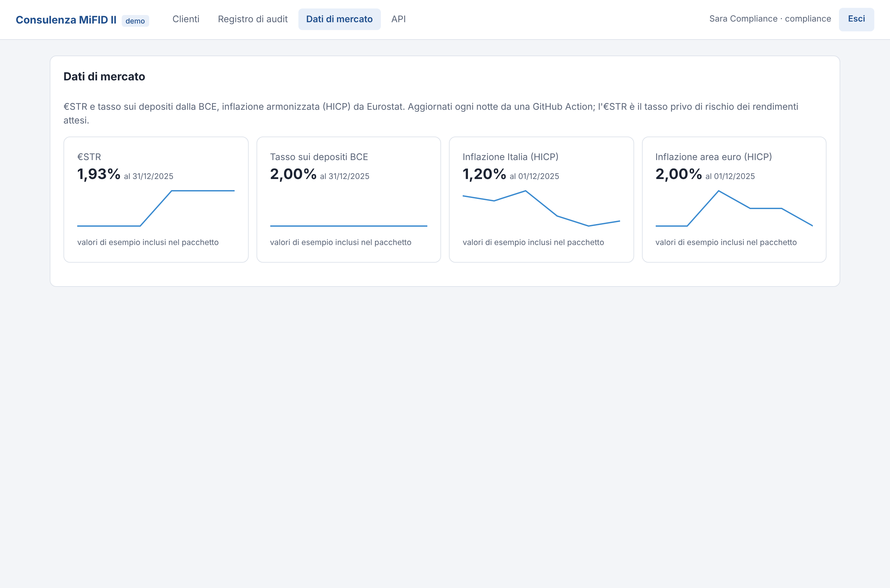

# MiFID II Advisory

**Piattaforma di consulenza finanziaria con profilazione MiFID II: questionario, profilo di rischio, proposta di
portafoglio ottimizzata, verifica di adeguatezza, dichiarazione per il cliente e registro di audit a prova di
manomissione. API REST con FastAPI, PostgreSQL, Docker e CI/CD.**

Prima di raccomandare un investimento, una banca o una società di consulenza deve conoscere il cliente, dimostrare
che la raccomandazione è adeguata e conservare tutto in modo che non possa essere alterato (direttiva 2014/65/UE,
Regolamento delegato 2017/565, Orientamenti ESMA sull'adeguatezza). Il progetto implementa questo processo dall'inizio
alla fine, come un servizio di back-end pronto per un front-end o per l'integrazione con altri sistemi:

1. il consulente registra il cliente e compila il **questionario** (conoscenza ed esperienza, situazione finanziaria,
   obiettivi, tolleranza al rischio, preferenze di sostenibilità);
2. il sistema calcola il **profilo** (classe di rischio da 1 a 5, strumenti ammessi, incoerenze da approfondire),
   valido 12 mesi;
3. propone un **portafoglio ottimizzato** sul profilo, oppure verifica una proposta costruita a mano;
4. esegue la **verifica di adeguatezza**, prodotto per prodotto e sul portafoglio, con motivazione e riferimento
   normativo per ogni controllo;
5. genera la **dichiarazione di adeguatezza** da consegnare al cliente;
6. registra ogni passaggio in un **registro di audit** a catena di hash: una modifica o una cancellazione diretta nel
   database viene individuata.



## Cosa fa

| Area | Contenuto |
|---|---|
| **Questionario** | Modelli **Pydantic** con validazione: 6 classi di strumenti con conoscenza ed esperienza, 3 domande di verifica (la conoscenza dichiarata va controllata, non solo autocertificata), situazione finanziaria, obiettivo e orizzonte, reazione a un ribasso, perdita massima, preferenze di sostenibilità (SFDR, Tassonomia UE, PAI) |
| **Profilo** | Classe finale = la più prudente fra **tolleranza al rischio**, **capacità di sostenere perdite** (patrimonio, reddito, debiti, persone a carico, età), **orizzonte** e **obiettivo**; certificati e derivati ammessi solo con conoscenza verificata; **controlli di coerenza** delle risposte richiesti dall'ESMA |
| **Prodotti** | Catalogo di 24 prodotti (monetari, titoli di Stato, ETF, fondi, certificati, azioni) con modello a fattori, costi, periodo di detenzione, mercato di riferimento, classificazione SFDR e **indicatore di rischio PRIIPs** (SRI) dalla volatilità |
| **Rischio** | Covarianza **Ledoit-Wolf**, expected shortfall al 95% (massimo fra parametrico e storico), probabilità di perdita, **scenari** sfavorevole, moderato e favorevole sull'orizzonte, costi in euro |
| **Ottimizzazione** | Massimo rendimento netto con vincoli di volatilità ed expected shortfall del profilo, liquidità per i 12 mesi, **concentrazione** per prodotto e per emittente, quote minime sostenibili e in tassonomia, solo prodotti adeguati (SLSQP) |
| **Adeguatezza** | Controlli `ok`, `attenzione`, `ko` su prodotto e portafoglio, con motivazione e articolo di riferimento; **analisi costi-benefici del cambio** quando la proposta sostituisce investimenti esistenti (art. 54(11) Reg. 2017/565); una proposta non adeguata viene salvata ma non può essere accettata |
| **Dati di mercato** | **€STR** e tasso sui depositi dalla **BCE** (API SDMX), **inflazione HICP** da **Eurostat** (JSON-stat), aggiornati ogni notte da una GitHub Action; l'€STR è il tasso privo di rischio dei rendimenti attesi |
| **Audit** | Registro **SHA-256 a catena**: ogni evento contiene l'impronta del precedente; l'endpoint di verifica indica il primo evento modificato o cancellato |
| **API** | **FastAPI** con documentazione OpenAPI, autenticazione **JWT** e tre ruoli (consulente, compliance, amministratore), errori leggibili |
| **Database** | **PostgreSQL** in produzione e SQLite in sviluppo, **SQLAlchemy 2.0** tipizzato, migrazioni **Alembic** applicate all'avvio |
| **Deploy** | Immagine **Docker**, `docker-compose` con PostgreSQL, **GitHub Actions** (lint, test su PostgreSQL 16, avvio dello stack), blueprint per **Render** |

Il catalogo prodotti e le serie dei rendimenti sono **simulati** (ISIN fittizi `XX…`): il progetto mostra il processo,
non raccomanda prodotti reali.

## Avvio rapido

Con Docker (API + PostgreSQL):

```bash
git clone https://github.com/Torraf-MI/mifid-advisory.git
cd mifid-advisory
docker compose up --build
```

Senza Docker (SQLite):

```bash
pip install -e ".[dev]"
mifid-advisory serve
```

Poi apri **http://localhost:8000** per la pagina dimostrativa e **http://localhost:8000/docs** per l'API. Al primo
avvio vengono creati tre utenti (`consulente@demo.it`, `compliance@demo.it`, `admin@demo.it`, password `demo`), il
catalogo e tre clienti di esempio con questionario e proposta.

| Accesso | Questionario |
|---|---|
|  |  |

## I tre clienti di esempio

| Cliente | Situazione | Profilo | Proposta | Esito |
|---|---|---|---|---|
| **Anna**, 34 anni | Crescita a 15 anni, preferenze ESG (30% sostenibile, PAI) | 4 · Dinamico | Quattro ETF e fondi azionari ESG, volatilità 14,9% | Adeguata |
| **Giorgio**, 58 anni | Ha già due fondi della banca, vuole cambiare | 4 · Dinamico | ETF diversificati e un certificato; il cambio rende circa 85.000 € in più sull'orizzonte contro 810 € di costi | Adeguata, con analisi costi-benefici |
| **Lucia**, 72 anni | Protezione del capitale, dichiara di conoscere i certificati ma sbaglia la domanda sulla barriera | 2 · Moderato | Monetario e titoli di Stato | Adeguata con avvertenze: i certificati restano esclusi |

## Esempio con l'API

```bash
# Token
TOKEN=$(curl -s -X POST localhost:8000/auth/token -d "username=consulente@demo.it&password=demo" | jq -r .access_token)
H="Authorization: Bearer $TOKEN"

# Nuovo cliente e questionario (esempio completo in docs/questionario_esempio.json)
curl -s -X POST localhost:8000/clienti -H "$H" -H "Content-Type: application/json" \
     -d '{"nome": "Paolo", "cognome": "Rossi", "data_nascita": "1980-03-01"}'
curl -s -X POST localhost:8000/clienti/4/questionari -H "$H" -H "Content-Type: application/json" \
     -d @docs/questionario_esempio.json

# Proposta ottimizzata da 100.000 € con verifica di adeguatezza
curl -s -X POST localhost:8000/clienti/4/proposte -H "$H" -H "Content-Type: application/json" -d '{"importo": 100000}'

# Dichiarazione per il cliente, decisione e verifica del registro (ruolo compliance)
curl -s localhost:8000/proposte/4/dichiarazione -H "$H" > dichiarazione.html
curl -s -X POST localhost:8000/proposte/4/accetta -H "$H" -H "Content-Type: application/json" -d '{"note": "firmata"}'
```

| Metodo | Endpoint | Ruoli |
|---|---|---|
| `POST` | `/auth/token` | tutti |
| `GET` | `/clienti`, `/clienti/{id}`, `/clienti/{id}/profilo` | consulente (solo i propri clienti), compliance, admin |
| `POST` | `/clienti`, `/clienti/{id}/questionari`, `/clienti/{id}/proposte` | consulente del cliente, admin |
| `GET` | `/proposte/{id}`, `/proposte/{id}/dichiarazione` | come i clienti |
| `POST` | `/proposte/{id}/accetta`, `/proposte/{id}/rifiuta` | consulente del cliente, admin |
| `GET` | `/prodotti`, `/mercato` | tutti |
| `POST` | `/mercato/aggiorna`, `/utenti` | admin |
| `GET` | `/audit`, `/audit/verifica` | compliance, admin |

Un consulente che chiede il cliente di un collega riceve `404`, non `403`: l'API non rivela nemmeno che esiste.

## Dichiarazione di adeguatezza

Generata dai dati salvati, spiega perché la raccomandazione corrisponde al profilo (art. 25(6) MiFID II, art. 54(12)
Reg. 2017/565): profilo e componente che lo determina, prodotti, rischi, scenari, costi in euro, esito di ogni
controllo. In fondo riporta l'impronta SHA-256 dell'evento di audit con cui la proposta è stata registrata.



## Registro di audit

MiFID II chiede di conservare le registrazioni in modo che non possano essere alterate senza lasciare traccia
(art. 16(6) della direttiva, art. 72 del Reg. 2017/565). Ogni evento (cliente creato, questionario, profilo,
proposta, decisione, aggiornamento dei dati) salva il contenuto e l'impronta dell'evento precedente; la propria
impronta è calcolata su entrambi, come in un registro distribuito. Se qualcuno modifica o cancella una riga
direttamente nel database, la verifica indica il primo evento non più coerente:

```bash
mifid-advisory verifica-audit
# {"integro": false, "eventi": 3, "primo_errore": 3, "motivo": "contenuto modificato dopo la registrazione"}
```

L'evento successivo viene scritto bloccando l'ultimo (`SELECT … FOR UPDATE`), così due richieste contemporanee non
creano due rami della catena; le date sono normalizzate in UTC perché PostgreSQL le restituisce nel fuso della
sessione (i test girano su un server impostato su `Europe/Rome`).



## Dati di mercato

```bash
mifid-advisory aggiorna-mercato
```

| Serie | Fonte | Uso |
|---|---|---|
| €STR | BCE, `EST/B.EU000A2X2A25.WT` | Tasso privo di rischio dei rendimenti attesi |
| Tasso sui depositi | BCE, `FM/D.U2.EUR.4F.KR.DFR.LEV` | Riferimento per la liquidità |
| Inflazione Italia e area euro | Eurostat, `prc_hicp_manr` | Rendimento reale atteso |

L'aggiornamento è idempotente e una fonte che non risponde non blocca le altre. Al primo avvio senza rete vengono
caricati valori di esempio inclusi nel pacchetto (indicati come tali nella fonte), sostituiti al primo aggiornamento
riuscito. La GitHub Action [`mercato.yml`](.github/workflows/mercato.yml) gira ogni notte alle 5:30 UTC: con il
secret `MIFID_DATABASE_URL` aggiorna il database di produzione, altrimenti pubblica le serie scaricate come artefatto.



## Deploy

- **Render** (gratuito): *New → Blueprint* e seleziona il repository. [`render.yaml`](render.yaml) crea il database
  PostgreSQL e il servizio web dall'immagine Docker, con una chiave dei token generata. Il database gratuito di Render
  scade dopo 30 giorni: per una demo permanente basta un PostgreSQL esterno (Neon, Supabase) in `MIFID_DATABASE_URL`.
- **Qualunque servizio con container** (Fly.io, Railway, Cloud Run, Azure Container Apps): l'immagine legge la porta da
  `$PORT` e la configurazione da variabili d'ambiente.

| Variabile | Default | Descrizione |
|---|---|---|
| `MIFID_DATABASE_URL` | `sqlite:///./mifid.db` | Anche `postgres://…` come lo forniscono i servizi cloud |
| `MIFID_CHIAVE_SEGRETA` | chiave di sviluppo | Firma dei token; obbligatoria se `MIFID_DEMO=false` |
| `MIFID_DEMO` | `true` | Crea utenti e clienti dimostrativi su un database vuoto |
| `MIFID_MINUTI_TOKEN` | `60` | Durata dei token |
| `MIFID_VALIDITA_PROFILO_MESI` | `12` | Dopo la scadenza servono un nuovo questionario e un nuovo profilo |

## Struttura

```
src/mifid_advisory/
  questionario.py    questionario MiFID (Pydantic)
  profilazione.py    classe di rischio, conoscenza, coerenza
  prodotti.py        catalogo, modello a fattori, SRI PRIIPs
  rischio.py         covarianza, expected shortfall, scenari, costi
  ottimizzazione.py  portafoglio ottimo sui vincoli del profilo
  adeguatezza.py     controlli di adeguatezza con riferimenti normativi
  db.py              tabelle SQLAlchemy;  migrazioni/  Alembic
  audit.py           registro a catena di hash
  mercato.py         pipeline BCE ed Eurostat
  servizi.py         logica applicativa (una transazione per operazione)
  sicurezza.py       password PBKDF2, token JWT, ruoli
  dichiarazione.py   dichiarazione di adeguatezza (Jinja2)
  api/               FastAPI: app, endpoint, schemi
  static/            pagina dimostrativa (HTML e JavaScript, senza framework)
```

## Test

```bash
pytest                                                    # 38 test su SQLite
MIFID_TEST_POSTGRES=postgresql://… pytest                 # gli stessi test anche su PostgreSQL
```

Unitari (profilo, ottimizzazione, adeguatezza, metriche, parser BCE ed Eurostat) e di integrazione sull'API: flusso
completo, permessi dei ruoli, proposte non valide, profilo scaduto, manomissione del registro. In CI girano su
PostgreSQL 16 e poi viene avviato lo stack `docker compose` con una chiamata autenticata.

## Limiti

- Prodotti e rendimenti simulati; soglie del profilo e pesi del questionario sono scelte di progetto ragionevoli, non
  la policy di un intermediario reale.
- Non copre la valutazione periodica dell'adeguatezza, il target market negativo del produttore, né la firma
  elettronica della dichiarazione.
- L'autenticazione è a token con password; in produzione si affiancherebbe a un fornitore di identità (OIDC) e a
  limiti di frequenza sulle richieste.

## Licenza

MIT. Progetto dimostrativo, non costituisce consulenza finanziaria.
